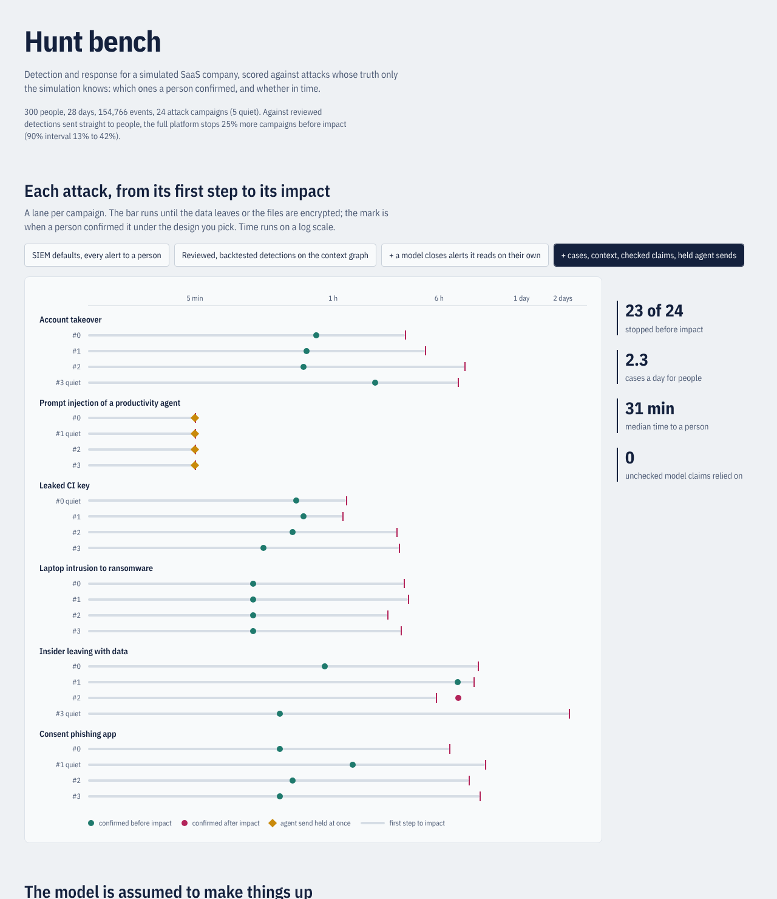

# agent-hunt-bench

Detection and response for a SaaS company, measured against attacks whose truth is known: detections written as code
and backtested before they merge, a context graph that joins five log sources into one person, a language model that
triages cases but whose every claim is checked by code, and containment playbooks that run dry until a person approves.

Public write-ups of agentic threat hunters describe these parts (a precomputed context graph, a deterministic claim
checker, an agent that opens detection merge requests) without accuracy numbers. This repository puts numbers on them:
a simulated company of 300 people over 28 days, 154,766 events from identity, documents, productivity agents,
cloud and endpoints, and 24 attack campaigns of six kinds, 5 of them in a quieter variant. The simulation keeps the
truth; the detections, the graph and the routing never see it.



## Dashboard

| Design | Caught | Stopped before impact | Median time to a person | Cases a day for people | Pages a day | Precision | Attack alerts the model closed | Unchecked claims relied on |
|---|--:|--:|--:|--:|--:|--:|--:|--:|
| SIEM defaults, every alert to a person | 20 of 24 | 7 of 24 | 8.4 h | 64.6 | 0.0 | 5% | 0 | 0 |
| Reviewed, backtested detections on the context graph | 24 of 24 | 17 of 24 | 51 min | 11.1 | 2.29 | 78% | 0 | 0 |
| + a model closes alerts it reads on their own | 24 of 24 | 18 of 24 | 51 min | 8.4 | 1.93 | 95% | 11 | 26 |
| **+ cases, context, checked claims, held agent sends** | 24 of 24 | 23 of 24 | 31 min | 2.3 | 0.43 | 78% | 0 | 0 |

The full platform stopped **23 of 24** campaigns before impact while asking people to read **2.3 cases a day**,
against 17 of 24 and 11.1 a day when every reviewed detection goes to a person, and 7 of 24 and 64.6
a day on SIEM defaults. On the same campaigns, the gain over detection as code is 25.0% of campaigns
(90% interval 12.5% to 41.7%), and over the model alone
20.8% (8.3% to 33.3%).

Where the gain comes from, by attack:

| Attack | SIEM defaults | Detection as code | + model alone | Platform | Median time from first step to impact |
|---|--:|--:|--:|--:|--:|
| Account takeover | 2/4 | 4/4 | 4/4 | 4/4 | 8.2 h |
| Insider leaving with data | 1/4 | 3/4 | 3/4 | 3/4 | 11.5 h |
| Consent phishing app | 4/4 | 4/4 | 4/4 | 4/4 | 11.8 h |
| Prompt injection of a productivity agent | 0/4 | 0/4 | 0/4 | 4/4 | 5 min |
| Leaked CI key | 0/4 | 2/4 | 3/4 | 4/4 | 2.9 h |
| Laptop intrusion to ransomware | 0/4 | 4/4 | 4/4 | 4/4 | 3.3 h |

- Prompt injection of a productivity agent reaches its impact within minutes of the injected instruction. No queue is
  fast enough; holding the agent's send to a new destination, which is reversible, is the only control that stops it.
- A model reading alerts on their own closed 11 alerts from real attacks and relied on
  26 claims that cite events that do not exist or misquote them. With the person's context, the code rule that it
  never closes a critical alert, and the claim checker, the platform closed 0 and relied on 0.
- Reading drops in two steps: 11.1 alerts a day group into 4.1 cases a day on one person each, and the
  model closes most of the benign ones, leaving 2.3 for people.

## The claim checker

The model is assumed to hallucinate. Every report names the events and field values it relies on; code checks each
against the event store before the verdict counts. A report that fails goes to a person whatever it concluded.

|  | Reports written | Failed the check | Escalations resting on an unsupported claim | Closures resting on an unsupported claim |
|---|--:|--:|--:|--:|
| Model alone | 156 | not checked | 21 | 5 |
| Platform | 58 | 5 | 0 | 0 |

The checker verifies citations, not reasoning: a report that quotes real events and draws the wrong conclusion passes.
That is why criticals cannot be closed by the model at all.

## Detections

Each detection is a YAML file with its condition, severity, ATT&CK or ATLAS technique, examples it must fire on and
stay quiet on, and a false-positive budget. CI lints every file (`scripts/check_detections.py`); the evaluation replays
each one on a week of attack-free history after a week of learning, and the gate fails any detection over budget.
Two first drafts failed that backtest and were rewritten; their history is in the files' comments.

| Detection | Kind | Source | Technique | Severity | Alerts | From attacks | Campaigns | False alerts a day in backtest | Budget | CI |
|---|---|---|---|---|--:|--:|--:|--:|--:|--:|
| [`agent_large_external_send`](detections/rules/agent_large_external_send.yaml) | match | agent | T1567 | medium | 3 | 3 | 3 | 0.0 | 0.2 | pass |
| [`agent_untrusted_instruction_egress`](detections/rules/agent_untrusted_instruction_egress.yaml) | new_value | agent | AML.T0051 | critical | 4 | 4 | 4 | 0.0 | 0.05 | pass |
| [`cloud_ci_key_recon`](detections/rules/cloud_ci_key_recon.yaml) | threshold | cloud | T1580 | high | 3 | 3 | 3 | 0.0 | 0.1 | pass |
| [`cloud_key_enumeration_call`](detections/rules/cloud_key_enumeration_call.yaml) | match | cloud | T1580 | medium | 4 | 4 | 4 | 0.0 | 0.1 | pass |
| [`cloud_key_outside_runners`](detections/rules/cloud_key_outside_runners.yaml) | match | cloud | T1078.004 | high | 6 | 6 | 3 | 0.0 | 0.1 | pass |
| [`cloud_snapshot_shared`](detections/rules/cloud_snapshot_shared.yaml) | match | cloud | T1537 | critical | 4 | 4 | 4 | 0.0 | 0.05 | pass |
| [`edr_copy_to_removable`](detections/rules/edr_copy_to_removable.yaml) | match | edr | T1052.001 | medium | 1 | 1 | 1 | 0.0 | 0.2 | pass |
| [`edr_keychain_dump`](detections/rules/edr_keychain_dump.yaml) | match | edr | T1555.001 | critical | 4 | 4 | 4 | 0.0 | 0.05 | pass |
| [`edr_leaver_removable_copy`](detections/rules/edr_leaver_removable_copy.yaml) | match | edr | T1052.001 | critical | 1 | 1 | 1 | 0.0 | 0.05 | pass |
| [`edr_mass_rename`](detections/rules/edr_mass_rename.yaml) | match | edr | T1486 | critical | 4 | 4 | 4 | 0.0 | 0.05 | pass |
| [`edr_pipe_to_shell_from_mail`](detections/rules/edr_pipe_to_shell_from_mail.yaml) | match | edr | T1059.004 | critical | 4 | 4 | 4 | 0.0 | 0.05 | pass |
| [`edr_ssh_into_colleague_device`](detections/rules/edr_ssh_into_colleague_device.yaml) | match | edr | T1021.004 | high | 4 | 4 | 4 | 0.0 | 0.1 | pass |
| [`idp_login_after_mfa_burst`](detections/rules/idp_login_after_mfa_burst.yaml) | sequence | idp | T1078 | critical | 3 | 3 | 3 | 0.0 | 0.1 | pass |
| [`idp_mfa_fatigue`](detections/rules/idp_mfa_fatigue.yaml) | threshold | idp | T1621 | high | 2 | 2 | 2 | 0.0 | 0.2 | pass |
| [`idp_new_country`](detections/rules/idp_new_country.yaml) | new_value | idp | T1078 | low | 15 | 3 | 3 | 0.57 | 2.0 | pass |
| [`idp_risky_oauth_grant`](detections/rules/idp_risky_oauth_grant.yaml) | match | idp | T1528 | high | 3 | 3 | 3 | 0.0 | 0.1 | pass |
| [`idp_session_replay`](detections/rules/idp_session_replay.yaml) | match | idp | T1550.004 | high | 0 | 0 | 0 | 0.0 | 0.1 | pass |
| [`saas_app_mass_read`](detections/rules/saas_app_mass_read.yaml) | threshold | saas | T1550.001 | high | 13 | 13 | 3 | 0.0 | 0.2 | pass |
| [`saas_bulk_export`](detections/rules/saas_bulk_export.yaml) | match | saas | T1567 | critical | 8 | 8 | 8 | 0.0 | 0.05 | pass |
| [`saas_leaver_downloads`](detections/rules/saas_leaver_downloads.yaml) | threshold | saas | T1530 | high | 6 | 6 | 4 | 0.0 | 0.2 | pass |
| [`saas_mass_download`](detections/rules/saas_mass_download.yaml) | threshold | saas | T1530 | medium | 34 | 34 | 7 | 0.0 | 0.2 | pass |
| [`saas_new_app_reads`](detections/rules/saas_new_app_reads.yaml) | new_value | saas | T1550.001 | medium | 4 | 4 | 4 | 0.0 | 0.2 | pass |
| [`saas_new_download_client`](detections/rules/saas_new_download_client.yaml) | new_value | saas | T1530 | medium | 12 | 1 | 1 | 0.71 | 1.0 | pass |
| [`saas_share_to_personal`](detections/rules/saas_share_to_personal.yaml) | match | saas | T1567 | medium | 14 | 3 | 3 | 0.14 | 1.5 | pass |

## ATT&CK coverage

Which designs saw each stage of each attack at all, before any routing.

| Attack | Stage | Technique | SIEM defaults | Detection as code | + model alone | Platform |
|---|---|---|--:|--:|--:|--:|
| Account takeover | mfa_fatigue | T1621 | ✓ | ✓ | ✓ | ✓ |
| Account takeover | access | T1078 | ✓ | ✓ | ✓ | ✓ |
| Account takeover | collection | T1530 | ✓ | ✓ | ✓ | ✓ |
| Account takeover | exfil | T1567 | ✓ | ✓ | ✓ | ✓ |
| Insider leaving with data | collection | T1530 | ✓ | ✓ | ✓ | ✓ |
| Insider leaving with data | exfil | T1567 | ✓ | ✓ | ✓ | ✓ |
| Consent phishing app | grant | T1528 | ✓ | ✓ | ✓ | ✓ |
| Consent phishing app | collection | T1550.001 |  | ✓ | ✓ | ✓ |
| Consent phishing app | exfil | T1567 | ✓ | ✓ | ✓ | ✓ |
| Prompt injection of a productivity agent | injection | AML.T0051 |  |  |  |  |
| Prompt injection of a productivity agent | exfil | T1567 |  | ✓ | ✓ | ✓ |
| Leaked CI key | discovery | T1580 | ✓ | ✓ | ✓ | ✓ |
| Leaked CI key | exfil | T1537 | ✓ | ✓ | ✓ | ✓ |
| Laptop intrusion to ransomware | execution | T1059 | ✓ | ✓ | ✓ | ✓ |
| Laptop intrusion to ransomware | credentials | T1003 |  | ✓ | ✓ | ✓ |
| Laptop intrusion to ransomware | lateral | T1021.004 |  | ✓ | ✓ | ✓ |
| Laptop intrusion to ransomware | impact | T1486 | ✓ | ✓ | ✓ | ✓ |

## The context graph

Built from the directory, the device inventory and the agent registry, plus who used each laptop in the learning
weeks. Each person appears under 4.5 different identifiers across the log sources on average.

| Source | Events resolved to a person |
|---|--:|
| agent | 100.00% |
| cloud | 100.00% |
| edr | 100.00% |
| idp | 100.00% |
| saas | 100.00% |

11 laptops no longer match the inventory; their owner was learned from history for 9. Two
detections exist only because of the graph: an account logging in to a colleague's laptop, and someone serving notice
downloading in volume.

## One case end to end

`account_takeover-0` became `case-00025`. Minutes from the attacker's first step:

- **30 min** `idp_login_after_mfa_burst` fires (critical, T1078) on 5 events
- **30 min** `idp_new_country` fires (low, T1078) on 1 event
- **45 min** a person is paged (severity the model may not close) and confirms an incident; containment is planned
- **176 min** `saas_mass_download` fires (medium, T1530) on 30 events
- **203 min** `saas_bulk_export` fires (critical, T1567) on 1 event
- **203 min** the bulk export the attacker was working towards

The model's report cited 4 events; the checker found every claim in the evidence.

Containment planned at confirmation, in dry run: `revoke_sessions` on identity provider, `require_mfa_reenrol` on identity provider.

## Held-out environment

Not run yet. `python scripts/evaluate.py --heldout` runs it once and writes `config/heldout.lock`.

## How it works

```
 logs (idp, documents, agents, cloud, endpoint)      directory, device inventory, agent registry
        │                                                          │
        ▼                                                          ▼
 detection engine ◄── detections/rules/*.yaml           context graph: one person per identity
  match, threshold,      examples + backtest budget            │
  new value, sequence ◄────────────── enrich: person, status, whose device
        │
        ▼
 cases: one person, 24 hours ──► model reads the case with context ──► claim checker
        │                                       │                          │
   agent send to a new destination      escalate / close            failed → a person
   on injected instructions: held               │
        ▼                                       ▼
 page on-call (critical) or queue ──► person confirms ──► playbook, dry run until approved
```

Code decides every route; the model only reads and writes a report. `src/huntbench/pipeline.py` takes the model and
the people as functions, so the evaluation runs it with the simulated ones and production would run it with
`huntbench.llm.AnthropicTriager` and the real queue.

## Run it

```bash
pip install -e ".[dev]"
python -m pytest -q                  # ~3 s
python scripts/check_detections.py   # lint every detection against its examples
python scripts/evaluate.py           # ~7 s, writes reports/dev.json
python scripts/gate.py
python scripts/readme.py             # this file and web/public/data/console.json
cd web && npm ci && npm run dev      # the console
```

## Layout

```
src/huntbench/world/   the simulated company and attackers; holds the truth (evaluation and tests only)
src/huntbench/         detect, graph, cases, triage, pipeline, respond, llm
detections/rules/      the team's detections        detections/vendor/   the SIEM defaults compared against
config/                world, heldout, platform, gate
prompts/triage.md      what the model is shown
scripts/               evaluate, gate, check_detections, readme
web/                   the console (React, Vite, React Query, Framer Motion)
```

## Limits

The environment is simulated, so absolute numbers mean little; the comparison between designs on the same
environment is the point. The model is simulated too, with error rates set in `config/world.toml`; a live run needs
`ANTHROPIC_API_KEY` and replaces only the model function. Analysts are one rate of misses that grows with load.
Containment is planned and never executed here. Repository: https://github.com/manojrevenkar12-web/agent-hunt-bench
